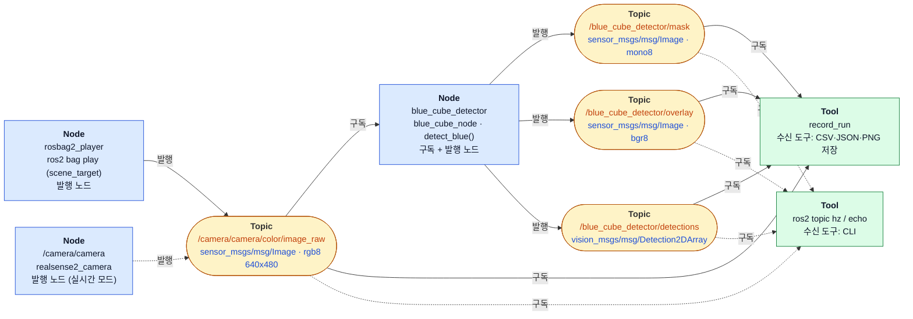
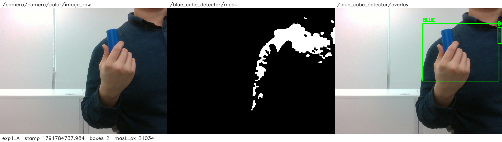
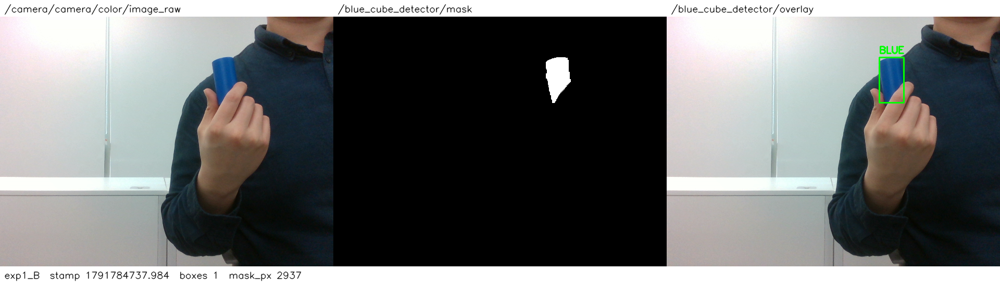
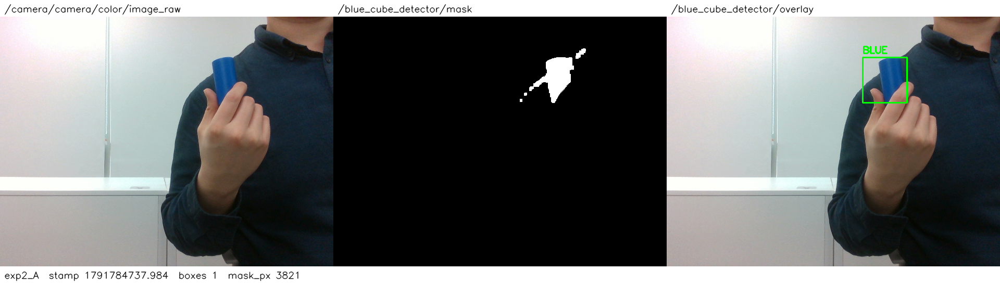
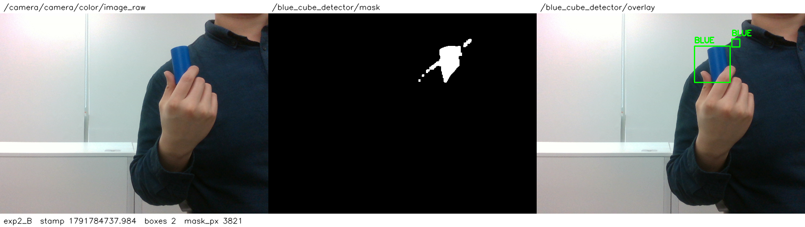
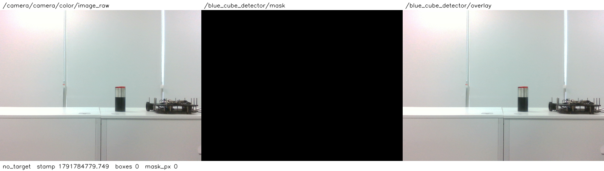

# 모듈 3 과제 보고서 — 설정값에 따른 Mask와 검출 결과 변화

- 작성자: 천경호
- 실행 방법·설정 파일 위치는 [README.md](README.md), 결과 파일은 [results/](results/)
- 이 보고서의 수치는 모두 ROS 2 토픽으로 발행한 값. (`record_run` 기록). 

---

## 1. 실행 환경과 입력

### 1.1 사용한 코드와 실행 명령

| 항목 | 내용 |
|---|---|
| 검출 코드 | 수업 코드 `blue_cube_reference.py`의 `detect_blue()` (19강 HSV·Contour 예제, 수정 없음) |
| ROS 2 노드 | `blue_cube_ros` 패키지의 `blue_cube_node` — Raw Image를 구독해 `detect_blue()`를 그대로 호출하고 Mask·Overlay·검출 결과를 발행 |
| 기록 도구 | `blue_cube_ros` 패키지의 `record_run` — 세 출력 토픽과 Raw를 구독해 stamp별로 저장 |
| 저장소·커밋 | `SpartaPA/physicalai-lv2-chunkyoungho`, 실험 실행 시점 커밋 `5b13588` (브랜치 `feature/m3-exp2`) |

수업 코드는 OpenCV 창(`imshow`)으로만 결과를 보여 주고 토픽을 발행하지 않습니다. 그래서 알고리즘은 바꾸지 않고, 결과를 토픽으로 내보내는 부분만 노드로 감쌌습니다.

```bash
# lv2_module3/ 에서 실행. 터미널 1: bag 재생 + 검출 노드
ros2 launch blue_cube_ros blue_cube.launch.py source:=bag params_file:=results/exp1/A/params.yaml
# 터미널 2: 토픽 기록
ros2 run blue_cube_ros record_run --out results/exp1/A --prefix exp1_A --snap 1791784737.984 --duration 15
```

### 1.2 ROS 2 환경

| 항목 | 값 |
|---|---|
| OS | Ubuntu 24.04.5 LTS (PC) |
| ROS 2 | Lyrical, RMW `rmw_fastrtps_cpp` |
| Python / OpenCV / NumPy | 3.12.3 / 4.6.0 / 1.26.4 |
| Camera 드라이버 | `ros-lyrical-realsense2-camera` 4.57.7 (librealsense2 2.57.7) |
| Camera | Intel RealSense D435, 펌웨어 5.15.1.55, USB 3.2 |

FastDDS 기본 공유 메모리 세그먼트(약 0.5 MB)가 640×480 이미지(약 0.9 MB)보다 작아서, 기본 설정으로는 이미지 프레임이 대부분 유실되었습니다. 모든 터미널에서 공유 메모리를 키우는 프로파일(`FASTDDS_DEFAULT_PROFILES_FILE`)을 지정해 해결했습니다.

### 1.3 입력 — 직접 녹화한 rosbag

실시간 Camera가 아니라, D435로 **직접 녹화한 rosbag**을 재생해 입력으로 사용. 같은 bag을 A·B에 똑같이 재생하고, 결과는 프레임의 `header.stamp`로 맞춰 비교했습니다.

| bag| 길이 | Raw 프레임 | 장면 | 용도 |
|---|---|---|---|---|
| `scene_target` | 11.61 s | 349장 (30.1 Hz) | 파란 원통을 손에 든 장면, 뒤에 남색 옷 | 실험 1·2 |
| `scene_no_target` | 11.29 s | 340장 (30.1 Hz) | 같은 자리, 원통 없음 | 목표 없음 확인 |

- 관찰 구간: `scene_target` 전체 (stamp `1791784732.179` ~ `1791784743.789`). 대표 프레임은 `1791784737.984`(중간 프레임)입니다.
- `scene_no_target`의 첫 프레임은 앞서 녹화한 장면의 마지막 프레임(stamp `1791784743.789`, 원통이 보임)이 들어가 있어서 재생할 때 `start_offset 0.1 s`로 건너뜀
- bag 원본(각 약 300 MiB)은 저장소에 넣지 않음. `ros2 bag info` 출력은 [results/input/](results/input/)에 있음.

**Raw Image:** 640×480, encoding `rgb8`, 30 Hz. 목표 물체는 손에 든 **파란 원통**. 배경에는 **남색 상의**가 있음. 원통은 밝고 채도가 높은 파랑이고, 상의는 어둡고 채도가 낮은 파랑.

---

## 2. 토픽 구성

| 자료 | 토픽 | 메시지 타입 | 발행 노드 | 수신 도구 | 수신 주기 |
|---|---|---|---|---|---|
| Raw Image | `/camera/camera/color/image_raw` | `sensor_msgs/msg/Image` (rgb8) | `rosbag2_player` | `record_run`(PNG 저장), `ros2 topic hz` | 29.98 Hz |
| Mask | `/blue_cube_detector/mask` | `sensor_msgs/msg/Image` (mono8) | `blue_cube_detector` | `record_run`(PNG 저장·픽셀 수), `ros2 topic hz` | 29.97 Hz |
| 검출 결과(수치) | `/blue_cube_detector/detections` | `vision_msgs/msg/Detection2DArray` | `blue_cube_detector` | `record_run`(CSV·메시지 원문), `ros2 topic hz` | 29.98 Hz |
| 검출 결과(Overlay) | `/blue_cube_detector/overlay` | `sensor_msgs/msg/Image` (bgr8) | `blue_cube_detector` | `record_run`(PNG 저장), `ros2 topic hz` | 29.98 Hz |

노드(사각형)와 토픽(둥근 상자)의 연결입니다. 토픽 상자 안에서 <span style='color:#c2410c'>주황</span>은 토픽 이름, <span style='color:#1d4ed8'>파랑</span>은 메시지 타입입니다. 실선은 실험에 쓴 경로이고, 점선은 실시간 Camera 모드(동작 확인용)와 CLI 확인입니다.



- 근거 파일: [results/topics/](results/topics/) — `ros2 topic list -t`, 토픽별 `ros2 topic info --verbose`(발행·구독 노드와 QoS), `ros2 topic hz`, `ros2 interface show`.
- 수신 증거: 네 설정 모두 `record_run`이 bag의 349개 stamp를 빠짐없이 받았습니다. 보고서의 이미지는 모두 토픽에서 받아 저장한 것입니다.

### 2.1 Mask의 의미

- 255(흰색): HSV 변환 후 `cv2.inRange(hsv, LOWER_BLUE, UPPER_BLUE)` 범위 안에 있고, 5×5 open·close를 거친 뒤에도 남은 픽셀
- 0(검정): 그 밖의 픽셀
- Mask 토픽은 **open·close 뒤, `MIN_AREA` 필터 앞**의 영상.  `min_area`를 바꿔도 Mask는 변하지 않아야 함..

### 2.2 검출 메시지 필드 ([예시 원문](results/exp1/B/exp1_B_detections_sample.yaml))

| 필드 | 의미 | 단위 |
|---|---|---|
| `header.stamp` | 입력 Raw Image의 stamp를 그대로 복사 → 같은 프레임의 Raw·Mask·Overlay와 연결 | s, ns |
| `detections[i].bbox.center.position.x`, `.y` | 박스 중심 (원본 해상도 기준, `x + (w-1)/2`) | px |
| `detections[i].bbox.size_x`, `.size_y` | 박스 폭·높이 (`cv2.boundingRect`) | px |
| `detections[i].id` | 박스 순번 | — |
| `detections[i].results` | 비어 있음. `detect_blue()`가 점수·클래스를 내지 않음 | — |
| 미검출 | `detections: []`를 매 프레임 발행 | — |

윤곽 면적(`contourArea`)과 검출 여부 필드는 메시지에 없습니다. Overlay는 `detect_blue()`가 원본 위에 초록 박스와 "BLUE" 글자를 그린 영상입니다.

### 2.3 처리 흐름과 코드 위치

```
/camera/camera/color/image_raw ──▶ blue_cube_node.on_image()        (blue_cube_node.py:47)
   rgb8 → bgr8 (cv_bridge)                                           (:49)
   detect_blue(frame)                                                (:50)  ← blue_cube_reference.py
      HSV 변환            cv2.cvtColor(frame, COLOR_BGR2HSV)         (blue_cube_reference.py:13)
      Mask 생성           cv2.inRange(hsv, LOWER_BLUE, UPPER_BLUE)   (:14)   ← 실험 1의 변수
      잡음 제거           open → close (5×5)                         (:16–17)
        └──▶ /blue_cube_detector/mask 발행                           (blue_cube_node.py:55)
      후보 찾기           cv2.findContours                           (:18)
      후보 필터           contourArea(c) >= MIN_AREA → boundingRect  (:19)    ← 실험 2의 변수
        ├──▶ /blue_cube_detector/overlay 발행                        (blue_cube_node.py:58)
        └──▶ /blue_cube_detector/detections 발행                     (blue_cube_node.py:71)
```

**설정값을 읽는 위치:** 노드가 시작할 때 ROS 2 파라미터 `lower_hsv`·`upper_hsv`·`min_area`를 읽습니다(`blue_cube_node.py:27–29`). 그 값으로 수업 코드의 상수 `LOWER_BLUE`·`UPPER_BLUE`·`MIN_AREA`(`blue_cube_reference.py:7–9`)를 덮어씁니다(`:31–33`). `detect_blue()`는 호출될 때마다 이 상수를 읽습니다.
- 파라미터는 시작할 때 한 번만 읽으므로, A·B는 설정 파일을 바꿔 노드를 **새로 실행**했습니다.
- 실제 적용값은 실행 중인 노드에서 파라미터 서비스로 다시 읽어 각 `*_summary.json`의 `applied_params`에 남겼습니다.

---

## 3. 실험 설계

| 실험 | 변경 변수 | A값 | B값 | 고정한 값 | 예상 변화 (실행 전) |
|---|---|---|---|---|---|
| 1 Mask 생성 | `lower_hsv`의 **V(밝기) 하한** | 50 (원본) | 95 | H 95~130, S ≥80, V ≤255, `min_area` 500 | B에서 어두운 상의가 Mask에서 빠지고 원통만 남아 박스가 원통 크기로 줄어듦 |
| 2 검출 후보 필터 | **`min_area`** [px²] | 500 (원본) | 100 | HSV `[95,80,80]~[130,255,255]` (A·B 동일) | Mask는 같고, B에서 100~500 px² 크기의 상의 파편이 후보로 통과해 박스가 늘어남 |

**두 실험 공통 통제 조건**
- 같은 bag(`scene_target`)의 349개 stamp
- 640×480 rgb8
- 같은 코드 커밋, 5×5 open·close
- 비교는 같은 stamp의 프레임끼리

설정 파일은 [results/exp1/](results/exp1/)과 [results/exp2/](results/exp2/)의 `A/params.yaml`, `B/params.yaml`이며, 실험마다 A·B는 한 줄만 다릅니다.

### 3.1 실험 1 — 왜 V 하한인가

원본 설정으로 돌리자 원통 뒤의 남색 상의가 파란색 범위에 걸렸습니다. 상의가 원통과 한 덩어리로 붙어 큰 박스가 생겼습니다.

변수를 정하기 위해 bag 프레임을 오프라인으로 분석해 두 물체의 HSV 분포를 비교했습니다(설계 근거, 토픽 수신 아님).

| 성분 | 원통 (p5 ~ p95) | 상의 (p5 ~ p95) | 분리 가능성 |
|---|---|---|---|
| H | 104 ~ 108 | 97 ~ 108 | 낮음. 상의 픽셀의 45.5 %가 원통의 H 범위 안 |
| S | 125 ~ 246 | 91 ~ 158 | 일부 겹침 (125~158) |
| V | 99 ~ 152 | 50 ~ 83 | 높음. 사이에 16 정도 여유 |

- 원통·상의 H는 70프레임, S·V는 중간 프레임 기준입니다.
- H로는 둘을 나눌 수 없고, S는 겹치는 구간이 있습니다. V만 두 범위 사이에 빈 구간이 있어 V 하한을 변수로 골랐습니다.
- B값 95는 상의 최댓값(83)보다 높고 원통 p5(99)보다 낮습니다.
- **예상:** `inRange` 조건 `V ≥ 95`에서 상의 픽셀 대부분이 0이 되고, 원통 픽셀은 대부분 255로 남을 것입니다.

### 3.2 실험 2 — 왜 min_area이고, 왜 HSV를 [95,80,80]로 고정했나

`min_area`는 Mask를 만든 **뒤에** 후보를 고르는 값입니다. 그래서 이 값의 효과를 보려면 Mask에 크기가 다양한 후보가 실제로 있어야 합니다. 오프라인으로 V 하한을 50~100 사이에서 바꿔 보며 확인했습니다.
- V 하한이 75 이상이면 원통이 상의와 떨어진 별도 덩어리가 됩니다.
- V 하한이 80일 때 상의는 반사로 밝은 부분만 작은 파편으로 남습니다.

그래서 실험 2의 HSV를 `[95,80,80]`으로 고정했습니다.
- **예상:** `contourArea ≥ MIN_AREA`에서 A(500)는 파편을 모두 떨어뜨리고, B(100)는 파편 일부를 통과시킬 것입니다. Mask는 A·B가 같을 것입니다.

---

## 4. 실험 결과와 분석

### 4.1 실험 1 — V 하한 50 → 95

**대표 프레임** (stamp `1791784737.984`, 왼쪽부터 Raw | Mask | Overlay)

A (V 하한 50):


B (V 하한 95):


**349프레임 비교** ([A CSV](results/exp1/A/exp1_A_detections.csv), [B CSV](results/exp1/B/exp1_B_detections.csv))

| 항목 | A (V ≥ 50) | B (V ≥ 95) |
|---|---|---|
| 프레임당 박스 수 | 1개 91 · 2개 156 · 3개 87 · 4개 15 (평균 2.07) | 모든 프레임 1개 |
| 가장 큰 박스 w×h (중앙값) | 289×220 px (넓이 63,510 px²) | 48×89 px (넓이 4,272 px²) |
| 가장 큰 박스 중심 (중앙값) | (479.0, 163.0) | (433.5, 121.5) |
| A의 가장 큰 박스 중심과 B 박스(원통) 중심의 거리 | 중앙 63.4 px (p5 52.0 ~ p95 88.6) | — |
| Mask 픽셀 수 (최소 / 중앙 / 최대) | 19,962 / 21,196 / 23,199 | 2,682 / 2,939 / 3,093 (A의 13.9 %) |

**관찰 (토픽 결과)**
- A의 Mask에는 원통과 함께 상의 어깨·가슴 영역이 크게 남았습니다.
- A의 가장 큰 박스는 모든 프레임에서 원통 중심을 포함합니다(349/349). 하지만 상의까지 덮는 289×220 박스라서 중심이 원통에서 평균 63 px 떨어져 있습니다. 목표는 박스 안에 들어 있지만 위치는 틀린 검출입니다.
- A에서는 상의 가장자리 조각이 프레임마다 0~3개의 박스로 더 생겼습니다.
- B의 Mask에는 원통만 남았고, 모든 프레임에서 원통 크기(48×89)의 박스 1개가 나왔습니다.

**코드 조건으로 본 원인**
- 바뀐 것은 `blue_cube_reference.py:14`의 `inRange` 하한 V 하나입니다.
- 상의 픽셀은 V가 50~83이라 B의 조건 `V ≥ 95`를 통과하지 못해 Mask에서 0이 됩니다.
- 원통은 V가 99 이상인 픽셀이 대부분이라 그대로 남습니다.
- Mask가 바뀌니 `findContours`가 찾는 덩어리도 바뀌었습니다. 상의와 붙어 있던 하나의 큰 덩어리가 원통 하나로 바뀌었고, 그래서 박스 수와 크기가 함께 바뀌었습니다.
- 예상과 같은 결과입니다.

### 4.2 실험 2 — min_area 500 → 100 (HSV [95,80,80] 고정)

**대표 프레임** (stamp `1791784737.984`)

A (min_area 500):


B (min_area 100):


**349프레임 비교** ([A CSV](results/exp2/A/exp2_A_detections.csv), [B CSV](results/exp2/B/exp2_B_detections.csv))

| 항목 | A (min_area 500) | B (min_area 100) |
|---|---|---|
| 프레임당 박스 수 | 모든 프레임 1개 | 1개 199 · 2개 146 · 3개 4 (평균 1.44) |
| Mask 픽셀 수 (최소 / 중앙 / 최대) | 3,262 / 3,718 / 4,057 | 3,262 / 3,718 / 4,057 |
| 같은 stamp에서 Mask 픽셀 수가 같은 프레임 | — | **349 / 349** |
| 같은 stamp에서 가장 큰 박스가 같은 프레임 | — | **349 / 349** (중앙 87×91) |
| B에만 있는 박스 | — | 154개 (150프레임). 박스 넓이 203~550 px²(중앙 376), w 12~25 · h 12~28 px, 중심 x 385~482 · y 66~135 |

**관찰 (토픽 결과)**
- Mask는 349프레임 모두에서 A와 B가 같습니다.
- A의 박스는 B에도 모두 그대로 있습니다(349/349).
- B에서만 원통 주변(x 385~482, y 66~135)의 작은 상의 파편이 박스로 추가됐습니다. 대표 프레임에서는 20×20 박스 하나가 늘었습니다.
- 원통 박스(87×91)는 A·B 모두 같습니다.

**코드 조건으로 본 원인**
- 바뀐 것은 `blue_cube_reference.py:19`의 `cv2.contourArea(c) >= MIN_AREA` 하나입니다. 이 조건은 Mask를 만든 뒤 후보를 고르는 단계라서 Mask에는 영향이 없습니다. Mask가 349/349 같다는 결과가 이를 보여 줍니다.
- B에서만 나온 박스는 B의 조건(≥100)은 통과하고 A의 조건(≥500)에서는 탈락한 후보입니다. 그러므로 윤곽 면적이 100 이상 500 미만입니다.
- 예상과 같은 결과입니다.

**예상하지 못한 점**
- 실험 2 HSV에서 원통 박스(87×91)가 원통만 잡았을 때(실험 1 B, 48×89)보다 넓습니다. 상의 가장자리가 원통 덩어리에 **붙은 채로** 남아 같은 윤곽이 되었기 때문으로 봅니다(이미지에서 확인한 추정).
- 같은 윤곽이라 면적 필터로는 떼어 낼 수 없습니다. 이 부분은 Mask 단계(실험 1의 V 하한)에서만 해결됩니다.

### 4.3 목표 없음 확인 — 최종 선택 설정

설정: `lower_hsv [95,80,95]`, `min_area 500` ([params](results/no_target/params.yaml)), 입력은 `scene_no_target`(첫 프레임 건너뜀)입니다.



| 항목 | 결과 |
|---|---|
| 받은 프레임 | 336장 (bag 340장 − 앞 0.1 s 4장) |
| 박스 수 | 모든 프레임 0개 |
| Mask 픽셀 수 | 모든 프레임 0 |
| 검출 메시지 | 매 프레임 `detections: []` 발행|

- 목표가 없을 때도 노드는 프레임마다 빈 검출 메시지와 Mask·Overlay를 계속 발행했습니다.
- 입력 bag 재생과 처리 노드가 멈추지 않고 동작한 것을 확인했습니다.

---

## 5. 선택값과 결론

### 5.1 선택값

| 파라미터 | 선택값 | 이유 |
|---|---|---|
| `lower_hsv` | **[95, 80, 95]** (V 하한 50 → 95) | 실험 1: 상의 오검출이 모든 프레임에서 사라지고, 원통은 모든 프레임에서 원통 크기 박스 1개로 검출됨 |
| `upper_hsv` | [130, 255, 255] (원본) | 이번 입력에서 바꿀 근거 없음 |
| `min_area` | **500** (원본 유지) | 실험 2: 100으로 낮추면 상의 파편이 오검출로 늘어남. 선택한 HSV에서는 파편이 없고 원통(약 2,700~3,000 px²)과도 여유가 있음 |

### 5.2 오검출과 미검출

| 값 | 너무 낮을 때 | 너무 높을 때 |
|---|---|---|
| V 하한 | 어두운 남색 옷 같은 배경이 Mask에 남아 **오검출**. 목표와 붙으면 박스 위치까지 틀어짐 (실험 1 A) | 그늘지거나 어두운 쪽의 목표 픽셀이 빠져 박스가 작아지고, 결국 **미검출**. 원통 V p5가 99라서 95는 여유가 작음 |
| `min_area` | 작은 파편이 박스로 통과해 **오검출** (실험 2 B) | 목표보다 크면 목표가 탈락해 **미검출**. 이 거리의 원통은 V 하한 95 기준 약 2,700~3,000 px² |

두 값은 하는 일이 다릅니다.
- **V 하한**은 Mask 단계에서 색이 비슷한 배경을 걸러 냅니다. 목표에 **붙어 있는** 배경도 떼어 낼 수 있습니다.
- **`min_area`**는 Mask에 남은 후보 중 **떨어져 있는 작은 후보**만 걸러 냅니다. 목표에 붙은 배경이나 큰 오검출 덩어리는 없앨 수 없습니다.

### 5.3 적용 범위와 한계

이 결론은 **이번 입력에서 확인한 범위**에만 해당합니다.
- **입력 범위:** bag 하나(약 11.6 s), 실내 조명 한 가지, 카메라와 원통 사이 거리 한 가지, 남색 상의 배경입니다.
- **조명:** 조명이 어두워지면 원통의 V도 낮아집니다. V 하한 95는 원통(p5 99)과 여유가 작아서 미검출이 생길 수 있습니다. 반대로 밝은 조명에서는 상의 V가 95를 넘을 수 있습니다.
- **거리:** 목표가 멀어지면 윤곽 면적이 거리 제곱에 반비례해 줄어듭니다. `min_area` 500은 이 거리에서 원통 면적의 약 1/6이지만, 먼 거리에서는 원통이 500 아래로 내려가 미검출될 수 있습니다. depth를 구독하여 거리를 제한하고, 거리에 따른 면적을 계산해서 구분하는 방법을 사용하면 조금 더 정확하게 걸러 낼 수 있을 것이라 기대됩니다.
- **손 움직임:** 원통을 손에 들고 있어 프레임마다 위치가 조금씩 다릅니다. A·B는 같은 bag 기록 같은 stamp끼리 비교해 이 영향을 없앴지만, 프레임 간 차이(박스 수 1~4개)는 장면 자체의 변화입니다.
- **설계 근거의 출처:** 3절의 HSV 분포는 bag 프레임을 오프라인으로 분석한 값입니다. 4절의 결과만 토픽으로 받은 값입니다.